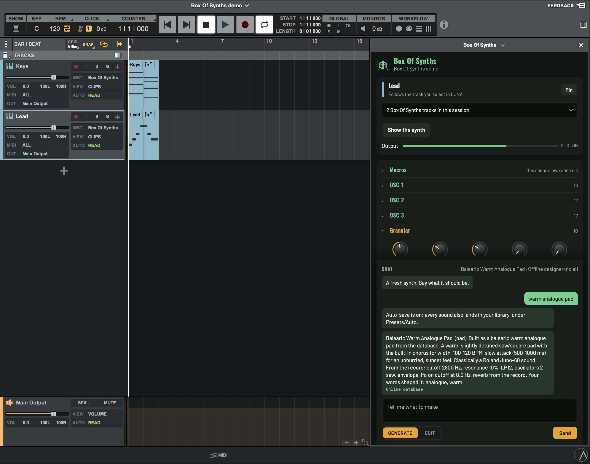

# Box Of Synths for LUNA

[](https://boxofrules.com/support)
[](https://www.paypal.com/donate/?hosted_button_id=25AW3DJVM8FPJ)
[](https://www.patreon.com/BoxOfRules)
[](https://ko-fi.com/Z7I0211Q00)

Box Of Synths beside the LUNA timeline. Put it on a track, play with its macros and every section
of the synth, chat to design sounds, and load your saved sounds, without opening the plug-in
window.



## Download

**[Box-Of-Synths-for-LUNA-0.5.0.lunaaddon](https://github.com/boxofrules/luna-box-of-synths/releases/latest)**
from the latest release, with its user guide (PDF).

## Needs

- LUNA 3.1.1 or later on macOS.
- [Box Of Synths](https://boxofsynths.com). The synth's controls and the chat need Box Of Synths
  1.1 or later; with 1.0 you get the track, your sounds and Output.

## Install

Double-click the `.lunaaddon`, or open it in LUNA. It appears under **Add Ons > Browsers > Box Of
Synths**. If it does not, quit LUNA and open it again.

## What it does

- **One panel, one track at a time.** The panel follows the track you select in LUNA, shown at the
  top in the track's colour. **Pin** keeps it on that track while you select others; the menu under
  it lists every Box Of Synths track in the session.
- **No synth on the track yet:** put Box Of Synths on it, or make a new Box Of Synths track.
- **Macros:** the sound's own controls, named as the sound names them.
- **Every control as the plug-in draws it:** dials (drag up or down, double-click to put one back),
  selector dials, Rate with HZ | SYNC, and the envelopes as graphs whose corners you drag. A
  section's on/off is the box on its title. Every section (oscillators, filter, envelopes, LFOs,
  each effect) folds open with a click.
- **Sounds:** search and load your saved sounds. With no Box Of Synths track selected, a sound makes
  a new track named after it.
- **Chat**, at the foot of the panel: tell it what to make (GENERATE) or what to change (EDIT),
  exactly as in the synth's own chat, at the same cost. Takes come into the panel: hold Play to hear
  one, Use to keep it.
- **Show the synth** opens Box Of Synths' own window. **Output** is its level.

A drag is one undo step in LUNA.

## Privacy

The panel talks only to the Box Of Synths on your Mac, at 127.0.0.1, with a per-instance secret
that only the host can read (the synth's read-only "Panel link" parameter). The chat sends what
the synth's own chat sends, by the method you chose in the synth. The add-on itself sends nothing
anywhere else.

## Build from source

Needs Node.js 22 or later and Universal Audio's LUNA Builder SDK installed at
`~/Library/Application Support/LUNA Builder SDK`. The SDK is not on npm, so `package.json` points
at that folder by a relative path: clone this repository to
`~/Documents/LUNA Add Ons/luna-box-of-synths`, or change the path in `package.json`.

```sh
npm install               # also copies the SDK's script bundle into vendor/
npm test                  # the logic against the SDK's MockEngine, no LUNA needed
npx ua-builder serve      # http://localhost:8790/ in a browser, talking to a running LUNA
npx ua-builder install    # link into LUNA's Add Ons folder; restart LUNA to see it
npx ua-builder pack       # build the .lunaaddon
```

| File | Purpose |
|---|---|
| `manifest.json` | Id `com.boxofrules.luna_box_of_synths`, target `browser` (the panel beside the timeline) |
| `index.html`, `style.css` | The page: Oswald and Barlow, Box Of Synths green |
| `logic.js` | LUNA logic with no DOM, tested on the mock |
| `main.js` | The page's wiring |
| `widgets.js`, `dial.js` | The dials, selectors and envelope graphs |
| `layout.js` | Box Of Synths' parameters in the synth's own order, generated from the plug-in |
| `tests/` | Vitest, with a fixture shaped like a real LUNA session |
| `brand/` | The Box Of Synths mark and the fonts |

Not tested on Windows yet.

## Licence

The add-on's code is MIT ([LICENSE](LICENSE)). The Box Of Synths and Box Of Rules names, marks and
icon are not covered by it: all rights reserved. Fonts and the SDK: see
[THIRD-PARTY-NOTICES.md](THIRD-PARTY-NOTICES.md).

LUNA and Universal Audio are trade marks of Universal Audio, Inc. This add-on is not affiliated with
or endorsed by Universal Audio.
